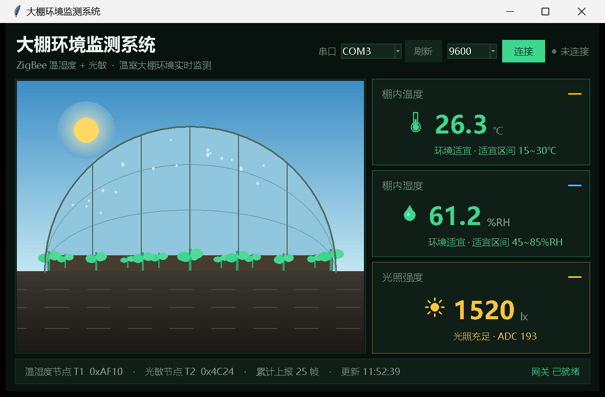
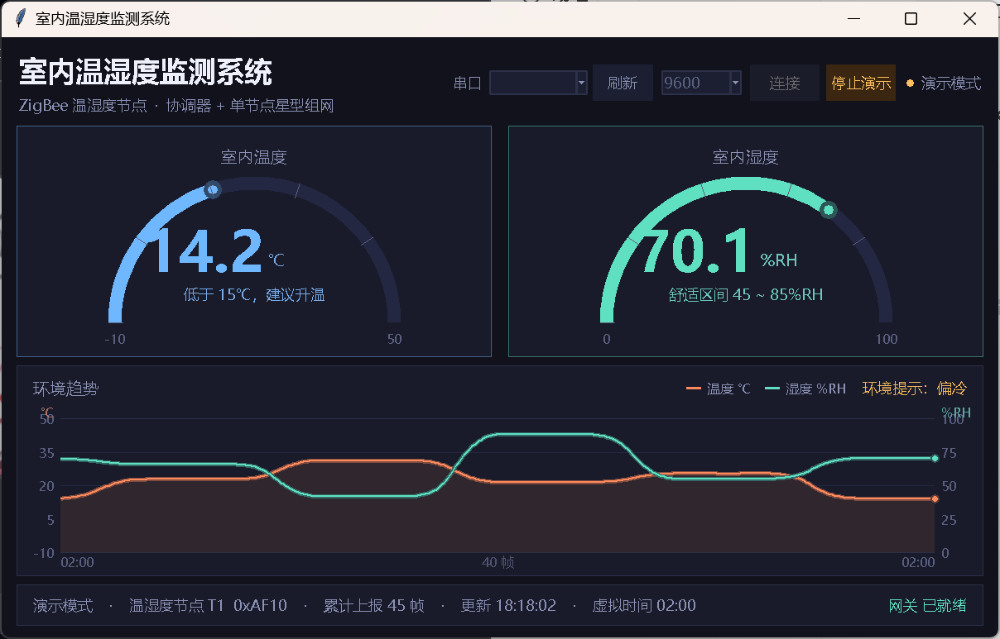
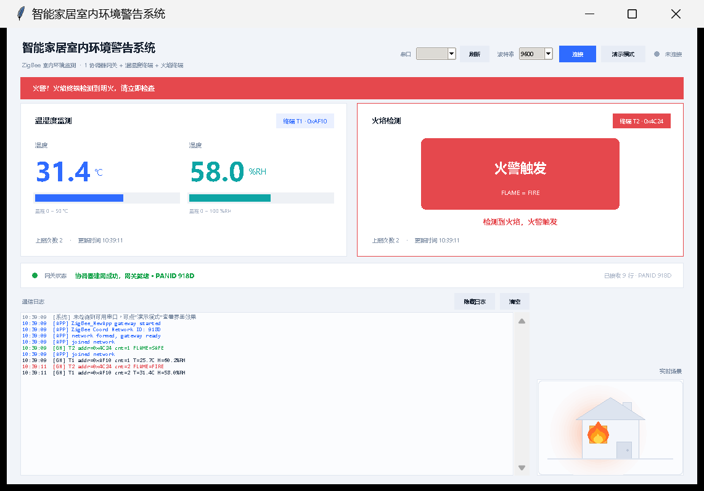
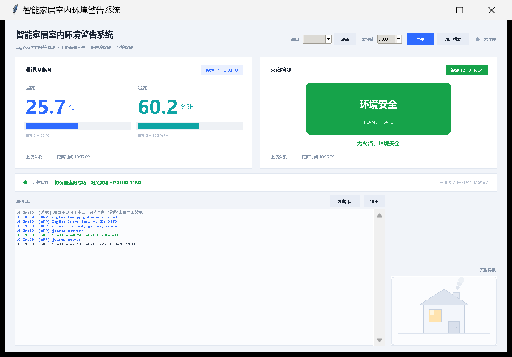
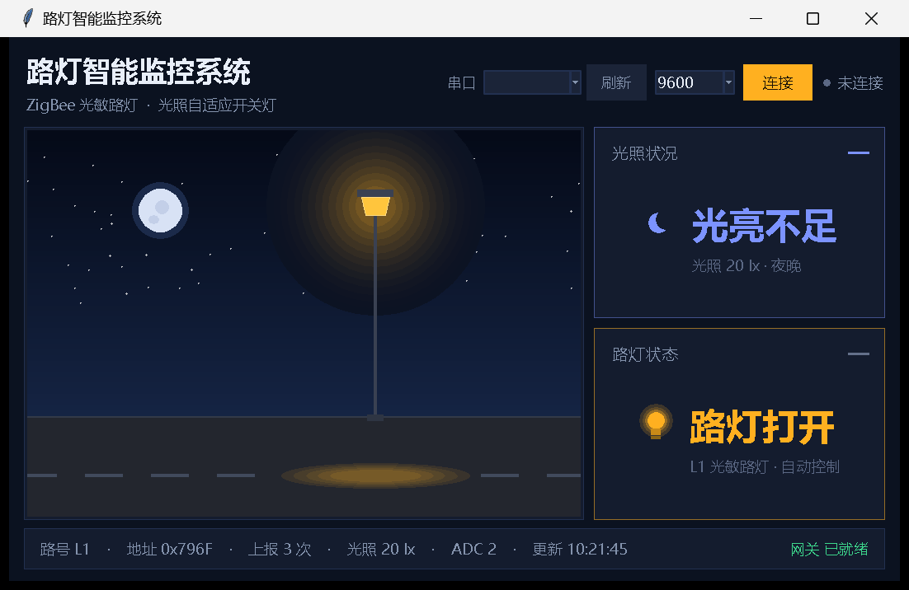
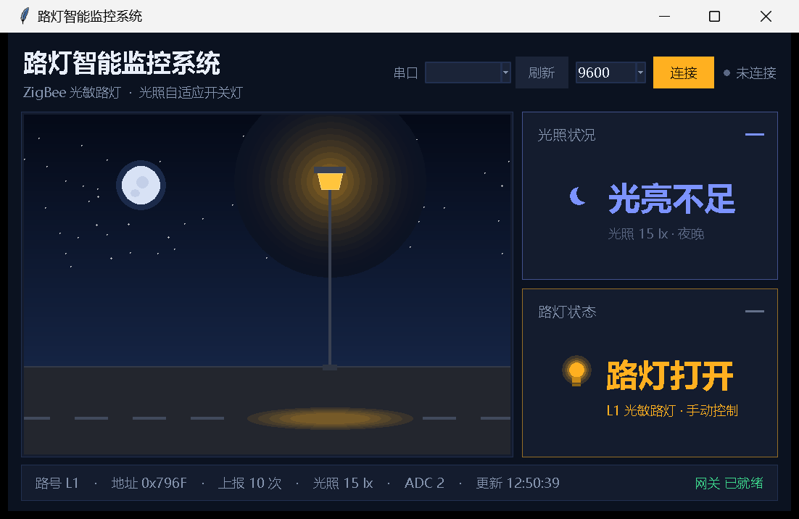
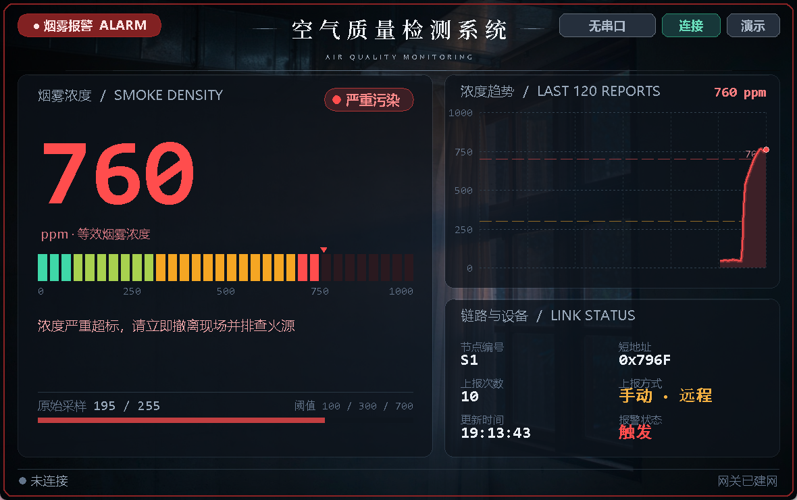

# CC2530 / Z-Stack 多节点项目合集

<p align="center">
  <b>同一套 CC2530 + Z-Stack 底座，五种业务形态的 ZigBee 无线传感网实战项目</b><br/>
  <sub>CC2530F256 · Z-Stack 2.5.1a · IAR EW8051 · Python + tkinter 上位机 · 串口 9600-8-N-1</sub>
</p>

<p align="center">
  
</p>

五个项目都是 **1 个协调器网关 + N 个终端节点** 的星型网：终端负责采集（温湿度 / 光照 / 火焰 / 烟雾），
协调器负责建网、收数据、按帧内容分类解析，再经串口送到 PC 上的上位机做实时可视化。
通信层、OSAL 调度、按键 / LED / 串口驱动五个项目完全一致，**差别只在应用层与传感器驱动层**——
这也是把它们放在一个合集里的原因：可以横向对比同一条链路在不同场景下怎么改。

---

## 目录

| # | 项目 | 网络形态 | 采集 / 控制对象 | 上位机界面 |
|:-:|---|---|---|---|
| 1 | [大棚环境监测](大棚环境监测/) | 1 协调器 + 温湿度终端 + 光敏终端 | 空气温度、湿度、光照强度 | 大棚剖面场景 + 三张状态卡片 |
| 2 | [室内温湿度监测](室内温湿度监测/) | 1 协调器 + 温湿度终端 | 空气温度、湿度 | 双半圆仪表 + 双 Y 轴趋势曲线 |
| 3 | [智能居家环境报警系统](智能居家环境报警系统/) | 1 协调器 + 温湿度终端 + 火焰终端 | 温湿度、明火 | 居家平面图 + 火警联动报警 |
| 4 | [智能路灯监控](智能路灯监控/) | 1 协调器 + 光敏路灯终端（可扩到 2 路） | 光照强度、路灯开关状态 | 路灯夜景 + 自动/手动控制 |
| 5 | [空气质量检测](空气质量检测/) | 1 协调器 + 烟雾终端 | 烟雾浓度（等效 ppm） | 写实底图 + 32 段 LED 光柱 + 波形 |

---

## 一、大棚环境监测

<p align="center">
  
</p>

温室大棚的补光与通风决策。温湿度终端与光敏终端各按 5 s 周期自动上报，网关按**帧内容**区分
哪一帧来自哪种终端（带 `T= H=` 的是温湿度，带 `LUX=` 的是光照），因此两个节点谁先上电都不影响界面表现。
光照低于 80 lx 判为「不足」，网关 LED3 常亮提示补光。上位机左侧是大棚剖面：天空亮度跟着光照等级走，
叶片颜色跟着温度走，棚膜上的水雾跟着湿度走。

**看点**：多终端同构、网关按内容分流、场景化可视化。[详细说明 →](大棚环境监测/README.md)

---

## 二、室内温湿度监测

<p align="center">
  
</p>

合集里最精简的一个：单终端、单指标，但界面的信息密度最高——两个半圆仪表 + 一张带面积填充的
双 Y 轴趋势图（最近 40 帧）。阈值判定 15 ℃ / 30 ℃、45 %RH / 85 %RH 与下位机 `NewApp.h` 里的宏一一对应，
仪表指针、卡片配色、趋势图的环境提示三者同源。

**看点**：仪表盘绘制、双 Y 轴折线、阈值与固件宏对齐。[详细说明 →](室内温湿度监测/README.md)

---

## 三、智能居家环境报警系统

<p align="center">
  
  
</p>

在温湿度监测的基础上加了火焰终端：**火焰状态变化立即上报**（不等周期），网关收到后 LED3 闪烁，
上位机切到火警界面。温湿度终端仍然按 5 s 周期上报。两种终端共用同一个 10 字节帧，
靠第 0 字节 `nodeType` 区分载荷——这是整个合集里「事件驱动 + 周期上报」并存的典型写法。

**看点**：事件触发上报、单帧多载荷复用、报警态界面切换。[详细说明 →](智能居家环境报警系统/README.md)

---

## 四、智能路灯监控

<p align="center">
  
  
</p>

合集里唯一带**下行控制**的项目：除了终端定时上报光照，网关还能按 KEY1 远程下发开灯 / 关灯命令
（控制簇 2，1 字节）。节点侧是「手动优先」策略——按过 KEY1 之后，即使天亮了路灯也保持点亮，
直到再按一次 KEY1 切回自动，或者按摇杆中键回到 `AUTO` 并按当前光照重新决策一次。
上报帧因此扩到 11 字节，多出一个 `mode` 字段告诉上位机当前是自动还是手动。

**看点**：上下行双向通信、手动/自动状态机、11 字节扩展帧。[详细说明 →](智能路灯监控/README.md)

---

## 五、空气质量检测

<p align="center">
  
</p>

烟雾浓度按 0~1000（等效 ppm）分四档：清新 / 轻度异味 / 明显烟雾 / 严重。终端每 5 s 上报一次，
网关除了显示，还能**反向请求终端立即补报**（控制簇 2，`0 = REPORT_NOW`），所以每一帧都带一个
`src` 字段，上位机能标出这帧是周期上报、本机按键触发还是网关请求的。

**看点**：四档分级报警、下行请求补报、帧来源可追溯。[详细说明 →](空气质量检测/README.md)

---

## 六、五个项目共用什么

| 层 | 内容 | 是否五个项目一致 |
|---|---|---|
| 协议栈 | TI Z-Stack 2.5.1a（`Components/`、`Projects/zstack/`） | 一致 |
| 调度 | OSAL 任务表 `OSAL_NewApp.c`，应用任务号与事件位固定 | 一致 |
| 通信 | 端点 20、Profile `0x0F08`、上报簇 1、终端向 `0x0000` 单播 | 一致 |
| 串口 | 协调器 UART0，9600-8-N-1，行文本协议 | 一致 |
| 驱动 | 按键（SW6 + 摇杆五向）、LED1~3、UART | 一致 |
| 传感器 | `sensor.c/.h`，**默认全部为模拟数据**，改一个宏即切真实模块 | 结构一致，实现不同 |
| 应用层 | `NewApp.c/.h`：采样、判定、组帧、上报、控制 | **各不相同** |

也就是说：把任一项目的 `Source/` 目录换掉，其余文件不动，就能从一种业务切到另一种业务。

---

## 七、目录结构

```
物联网5项目合集/
├── 大棚环境监测/
│   ├── README.md                     项目说明（界面预览 + 协议 + 验收）
│   ├── Components/                   Z-Stack 协议栈（TI 官方）
│   ├── Projects/zstack/              IAR 工程、ZMain、Libraries
│   └── 上位机/                        Python 上位机 + 预览图
├── 室内温湿度监测/                    同上结构
├── 智能居家环境报警系统/               同上结构
├── 智能路灯监控/                      同上结构
└── 空气质量检测/                      同上结构
```

每个项目内部的固件工程在 `Projects/zstack/Samples/ZigBee_NewApp/`，同一目录下的 `README.md`
是该项目的**完整技术文档**（编译配置、帧格式、按键 LED 定义、传感器接线、验收步骤）。

---

## 八、跑起来

### 8.1 只跑上位机（不需要任何硬件）

每个项目的上位机都自带演示模式：内置一份与真实固件**逐字一致**的串口输出脚本，
走的是同一个解析与渲染函数，不是另做一套假界面。

```bash
cd 大棚环境监测/上位机
pip install pyserial            # 仅接真实串口时需要
python 大棚环境监测.py --demo
```

### 8.2 接真实硬件

1. IAR EW8051 打开 `Projects/zstack/Samples/ZigBee_NewApp/CC2530DB/ZigBee_NewApp.eww`；
2. 按项目 README 里的「编译配置」表选择角色（协调器 / 各终端），`Rebuild All`；
3. CC Debugger 烧写对应 hex；
4. **先给协调器上电建网**，再给终端上电入网；
5. 协调器串口接 PC，上位机选串口连接（9600-8-N-1）。

### 8.3 硬件清单

| 器件 | 型号 | 说明 |
|---|---|---|
| 主控 | CC2530F256 开发板 ×2~3 | 协调器 1 块 + 终端 1~2 块 |
| 调试器 | CC Debugger | 烧写与在线调试 |
| 温湿度 | DHT11 | 单总线，默认 P0.7（居家版 P0.6） |
| 光照 | 光敏电阻模块（AO 优先） | 默认 P0.5 / AIN5，DO 备用 P0.4 |
| 火焰 | 火焰传感器模块 | 默认 P0.5，低电平有效 |
| 烟雾 | MQ-2 类烟雾模块 | 默认 P0.5 / AIN5，DO 备用 P0.4 |

不接传感器也能做完全部演示——各项目 `sensor.h` 里的模拟开关默认为 1。

---

## 九、关于代码来源

- `Components/` 与 `Projects/zstack/` 为 TI **Z-Stack 2.5.1a** 安装目录中的协议栈与工程骨架，
  版权归 Texas Instruments 所有，随工程保留以便直接编译；
- `Projects/zstack/Samples/ZigBee_NewApp/Source/` 下的 `NewApp.c/.h`、`sensor.c/.h`、
  `OSAL_NewApp.c` 为应用层改动部分；
- `上位机/` 下所有 Python 程序、界面与预览图为本合集自写。

仅供学习与课程实验参考，请勿用于商业用途。
