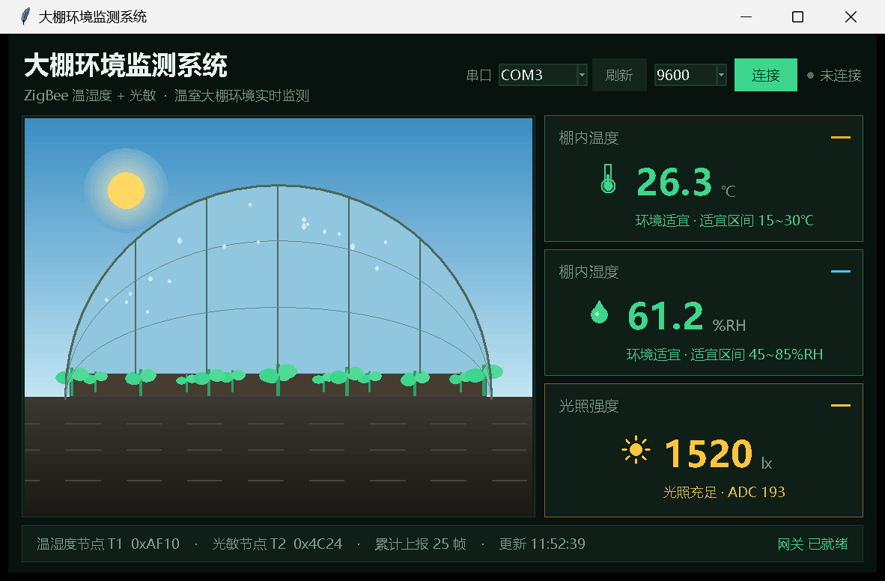
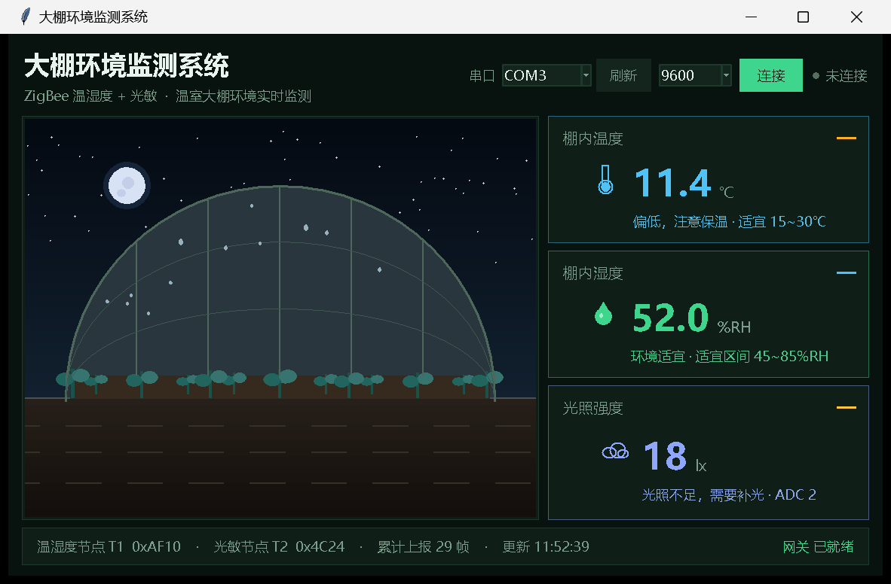
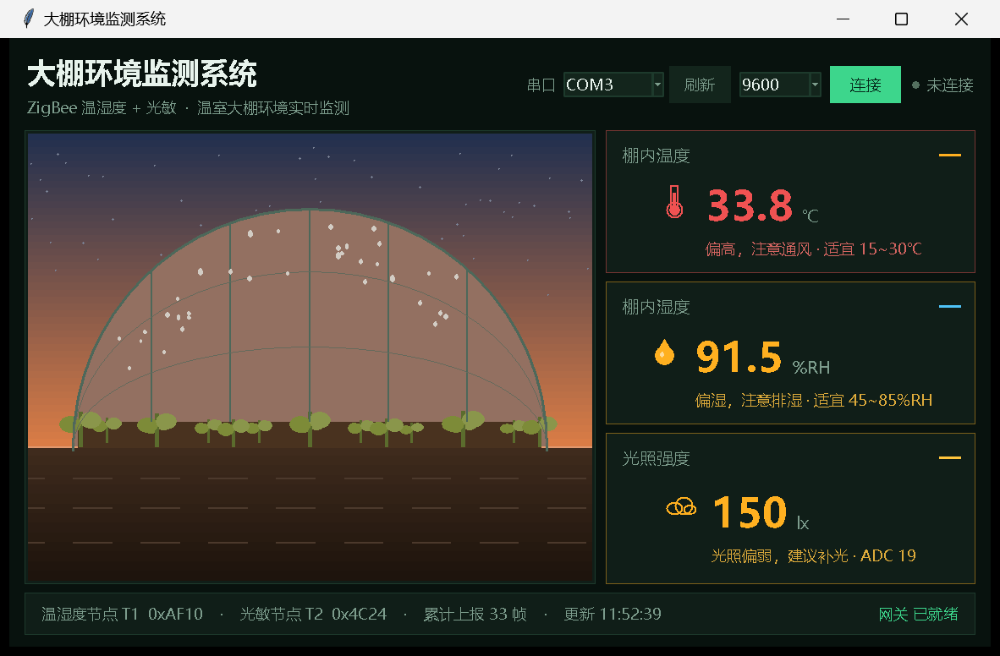

# 大棚环境监测

<p align="center">
  <b>CC2530 + Z-Stack 星型网：温湿度终端 + 光敏终端 → 协调器网关 → 上位机大棚场景</b><br/>
  <sub>CC2530F256 · Z-Stack 2.5.1a · IAR EW8051 · Python + tkinter</sub>
</p>

<p align="center">
  
</p>

温室大棚的日常管理，核心就三件事：温度够不够、湿度闷不闷、光照足不足——不足要补光，过热要通风，
过湿要放风降湿。这个项目把三个量采齐，并让上位机把数字翻译成一眼能看懂的场景。

---

## 一、系统组成

| 节点 | 角色 | 采集 / 动作 | 编译配置 |
|---|---|---|---|
| 协调器网关 | 建网、收数据、串口转发 | 按帧内容区分终端类型；LED1 亮=收到温湿度帧，LED2 亮=收到光照帧，LED3 常亮=光照不足 | `CoordinatorEB` |
| 温湿度终端 | 周期采集并上报 | DHT11 采空气温度 / 湿度，5 s 一帧 | `SensorTerminalEB` |
| 光敏终端 | 周期采集并上报 | 光敏采光照，判定等级后随帧上报，5 s 一帧 | `LightTerminalEB` |
| 路由中继（可选） | 拉远距离用 | 与温湿度终端同一份代码 | `RouterEB` |

网络形态是星型：两个终端都直接向 `0x0000` 单播，不经过路由。

---

## 二、界面预览

| 白天环境适宜 | 夜间光照不足 | 傍晚高温高湿 |
|---|---|---|
|  |  |  |

左侧是大棚剖面场景，三个元素分别由三个传感器驱动：

| 画面元素 | 数据来源 | 表现 |
|---|---|---|
| 天空与棚内亮度、太阳 / 月亮 / 星空 | 光照等级 `LEVEL` | 充足→白天，偏弱→傍晚，不足→夜间 |
| 叶片颜色 | 空气温度 | 偏冷发青、适宜翠绿、偏热发黄 |
| 棚膜上的露珠数量 | 空气湿度 | 越潮越多 |

右侧三张卡片给出温度、湿度、光照的数值与上下限判定；底部是两个节点的短地址、累计帧数、
最后更新时间与网关就绪状态。**界面不显示通信日志**，只看结果。

---

## 三、串口协议

协调器 UART0，9600-8-N-1，行文本：

```
[APP] ZigBee_NewApp gateway started
[APP] network formed, gateway ready
[GW] T1 addr=0xAF10 cnt=1 T=25.6C H=60.5%RH
[GW] T2 addr=0x4C24 cnt=1 LUX=18 ADC=2 LEVEL=NIGHT
[GW] T1 addr=0xAF10 cnt=2 T=25.7C H=60.2%RH
[GW] T2 addr=0x4C24 cnt=2 LUX=1260 ADC=160 LEVEL=DAY
```

| 字段 | 含义 |
|---|---|
| `T1` / `T2` | 网关按终端短地址**首次出现顺序**自动编号，不代表类型 |
| `addr` | 终端 16 位短地址 |
| `cnt` | 该终端累计上报次数，从 1 递增，可用于判断丢帧 |
| `T` / `H` | 空气温度 ℃ / 相对湿度 %RH |
| `LUX` / `ADC` | 光照强度 lx / 光敏原始采样 0~255 |
| `LEVEL` | `NIGHT` 不足 / `DUSK` 偏弱 / `DAY` 充足 |

> 网关按**帧内容**分流：带 `T= H=` 的算温湿度帧，带 `LUX=` 的算光照帧。
> 所以 `T1` 到底是哪块板，取决于谁先上电——上位机也不依赖编号，同样按内容判断。

---

## 四、上报数据帧（10 字节，小端）

两种终端共用同一个帧结构，第 0 字节 `nodeType` 决定载荷怎么解释：

| 偏移 | 温湿度帧（nodeType = 1） | 光敏帧（nodeType = 2） |
|:-:|---|---|
| 0 | 1 | 2 |
| 1-2 | 终端短地址 | 终端短地址 |
| 3-4 | 上报次数 | 上报次数 |
| 5-6 | 温度（0.1 ℃，int16） | 光照强度（lx，uint16） |
| 7-8 | 湿度（0.1 %RH，uint16） | 光敏 ADC（0~255）/ 光照等级（0/1/2） |
| 9 | 保留 | 保留 |

链路参数：端点 20、Profile `0x0F08`、上报簇 1、终端 → `0x0000` 单播。

---

## 五、判定逻辑

光照等级在**终端**判定，随帧一起上报；温湿度阈值放在**上位机**，方便随时调整不必重烧固件。

```
读光敏 → lux
   ↓
lux < 80   → NIGHT（不足，需要补光）
lux < 250  → DUSK （偏弱）
否则        → DAY  （充足）
   ↓
组帧单播给网关（lux / adc / level）
```

| 指标 | 偏低 / 偏干 | 适宜 | 偏高 / 偏湿 |
|---|---|---|---|
| 空气温度 | < 15 ℃ | 15 ~ 30 ℃ | > 30 ℃（> 32 ℃ 转红） |
| 空气湿度 | < 45 %RH | 45 ~ 85 %RH | > 85 %RH |
| 光照 | < 80 lx 不足 | ≥ 250 lx 充足 | 80 ~ 250 lx 偏弱 |

阈值宏在 `Source/NewApp.h`：`NEWAPP_LUX_NIGHT`（80）、`NEWAPP_LUX_DUSK`（250）、
`NEWAPP_REPORT_PERIOD`（5000 ms）。

---

## 六、目录结构

```
大棚环境监测/
├── README.md
├── Components/                                  Z-Stack 协议栈（TI 官方）
├── Projects/zstack/
│   ├── Libraries/                               TI 预编译库
│   ├── Samples/ZigBee_NewApp/
│   │   ├── CC2530DB/ZigBee_NewApp.eww           IAR 工作区（打开这个）
│   │   ├── Source/NewApp.c/.h                   应用层：采样、判定、组帧、上报
│   │   ├── Source/sensor.c/.h                   DHT11 + 光敏驱动（含模拟数据）
│   │   ├── Source/OSAL_NewApp.c                 OSAL 任务表
│   │   └── README.md                            完整技术文档（编译/按键LED/接线/验收）
│   ├── Tools/CC2530DB/f8wConfig.cfg             信道与 PANID
│   └── ZMain/                                   Z-Stack 主循环
└── 上位机/
    ├── 大棚环境监测.py                           Python 上位机
    ├── requirements.txt
    └── 预览图/
```

---

## 七、快速开始

### 7.1 上位机（无硬件先看效果）

```bash
cd 上位机
python 大棚环境监测.py --demo      # 演示模式，约 45 s 走完一昼夜
python 大棚环境监测.py COM3         # 接真实协调器
```

演示模式由 `DemoWorker` 按剧本生成串口行，**格式与真实固件逐字一致**（前缀 `[GW]`、字段名、单位都相同），
走的是同一个 `handle_line()`，不是另做一套假界面。一轮覆盖：凌晨低温高湿光照不足 → 日出转暖偏弱 →
上午适宜充足 → 正午高温偏干强光 → 傍晚降温回暖。

### 7.2 固件

1. IAR EW8051 打开 `Projects/zstack/Samples/ZigBee_NewApp/CC2530DB/ZigBee_NewApp.eww`；
2. Workspace 选择 `CoordinatorEB` → `Rebuild All` → CC Debugger 烧写；
3. 换成 `SensorTerminalEB`、`LightTerminalEB` 分别烧两块终端；
4. **先给协调器上电建网，再给终端上电**；协调器串口接 PC。

### 7.3 接真实传感器

`sensor.h` 里默认走模拟数据（`SENSOR_SIMULATE`、`SENSOR_LIGHT_SIMULATE` 均为 1），
不接任何模块即可完成组网与显示。接真实模块时：改这两处为 0，并按接线调整引脚宏。

| 传感器 | 方式 | 宏 | 默认引脚 |
|---|---|---|---|
| DHT11 温湿度 | 单总线 | `SENSOR_DHT11_BIT` | P0.7 |
| 光敏 | 模拟量 AO（推荐） | `SENSOR_LIGHT_ADC_CHN` | P0.5 / AIN5 |
| 光敏 | 开关量 DO | `SENSOR_LIGHT_DO_BIT` | P0.4 |

> 摇杆方向识别占用了 P0.6 / AIN6，所以 DHT11 放在 P0.7；若模块已接在 P0.6，把宏改回 `BV(6)` 即可。

---

## 八、验收要点

| 编号 | 测试项 | 操作 | 预期 |
|:-:|---|---|---|
| T1 | 协调器建网 | 仅协调器上电 | 串口输出 `gateway started`、`network formed, gateway ready` |
| T2 | 终端自检 | 终端单独上电 | 打印一次传感器读数（`temp/hum sensor ready` / `light sensor ready`） |
| T3 | 入网 | 终端上电 | 输出 `joined network` |
| T4 | 自动上报 | 不做任何操作 | 网关每 5 s 收到两帧，分别带 `T= H=` 与 `LUX= LEVEL=` |
| T5 | 光照周期 | 观察 60 s | `LEVEL` 出现 `NIGHT → DAY → NIGHT` |
| T6 | 光照不足提示 | 等到 `LEVEL=NIGHT` | 网关 LED3 常亮，恢复光照后熄灭 |
| T7 | 按键补报 | 按终端 S1 | 不等周期立即多发一帧，`cnt` 加 1 |
| T8 | 上位机 | 连接协调器串口 | 三张卡片与大棚场景实时刷新 |

---

## 九、完整文档

编译配置、按键 / LED 定义细节、传感器校准方法、组网参数与全部验收项，见
[`Projects/zstack/Samples/ZigBee_NewApp/README.md`](Projects/zstack/Samples/ZigBee_NewApp/README.md)。
