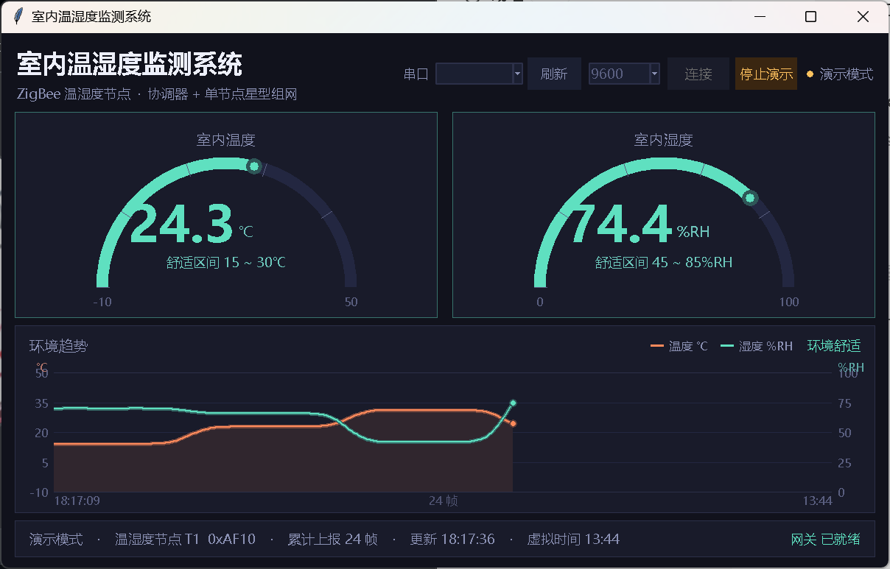
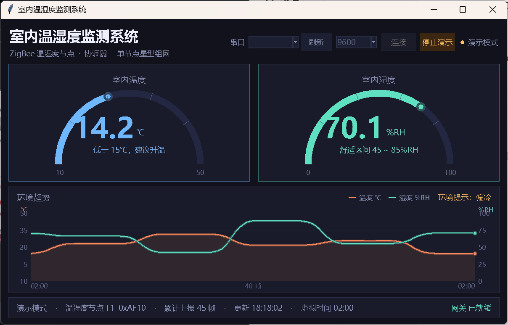

# 室内温湿度监测

<p align="center">
  <b>CC2530 + Z-Stack 单终端星型网：温湿度终端 → 协调器网关 → 双仪表 + 趋势曲线上位机</b><br/>
  <sub>CC2530F256 · Z-Stack 2.5.1a · IAR EW8051 · Python + tkinter</sub>
</p>

<p align="center">
  
</p>

合集里最精简的一个项目：一个终端、两个指标，但把「一个数字该以什么形式呈现」这件事做透了——
半圆仪表给瞬时值，趋势曲线给变化方向，卡片配色给结论。适合作为 ZigBee 组网 + 上位机解析的最小可运行范例。

---

## 一、系统组成

| 节点 | 角色 | 采集 / 动作 | 编译配置 |
|---|---|---|---|
| 协调器网关 | 建网、收数据、串口转发 | 解析上报帧，打印 `[GW]` 行；顺带给出舒适度判定 `ENV` | `CoordinatorEB` |
| 温湿度终端 | 周期采集并上报 | DHT11 采温度 / 湿度，上电先自检一次，之后 5 s 一帧 | `SensorTerminalEB` |
| 路由中继（可选） | 拉远距离用 | 与终端同一份代码 | `RouterEB` |

星型拓扑：终端直接向 `0x0000` 单播，一跳到达网关。

---

## 二、界面预览

| 舒适状态 | 偏冷状态 |
|---|---|
|  |  |

界面结构：

```
┌──────────────────────────────────────────────────┐
│ 顶部：标题 + 串口选择 + 波特率 + 连接 + 演示      │
├───────────────────────┬──────────────────────────┤
│  温度半圆仪表         │   湿度半圆仪表           │
├───────────────────────┴──────────────────────────┤
│  环境趋势：双 Y 轴折线，最近 40 帧，温度带面积填充 │
├──────────────────────────────────────────────────┤
│ 底部：节点短地址 / 累计帧数 / 更新时间 / 网关状态 │
└──────────────────────────────────────────────────┘
```

四层信息各司其职：**数值**看仪表、**趋势**看折线、**结论**看配色、**连通性**看底部状态。
仪表指针位置、卡片配色和趋势图右上角的环境提示，三个地方用的是同一套判定结果，不会互相打架。

---

## 三、串口协议

协调器 UART0，9600-8-N-1：

```
[APP] ZigBee_NewApp gateway started
[APP] network formed, gateway ready
[GW] T1 addr=0xAF10 cnt=1 T=25.6C H=60.5%RH ENV=OK
[GW] T1 addr=0xAF10 cnt=2 T=25.8C H=59.9%RH ENV=OK
```

| 字段 | 含义 |
|---|---|
| `T1` | 节点编号，网关按短地址首次出现顺序分配 |
| `addr` | 终端 16 位短地址 |
| `cnt` | 累计上报次数，连续递增说明链路稳定 |
| `T` / `H` | 温度 ℃ / 相对湿度 %RH |
| `ENV` | 网关侧舒适度判定：`OK` 舒适 / `ALARM` 越界 |

---

## 四、上报数据帧（10 字节，小端）

| 偏移 | 字段 | 说明 |
|:-:|---|---|
| 0 | nodeType | 1 = 温湿度终端 |
| 1-2 | addr | 终端短地址 |
| 3-4 | count | 上报次数 |
| 5-6 | temp | 温度，单位 0.1 ℃（有符号） |
| 7-8 | hum | 湿度，单位 0.1 %RH |
| 9 | reserved | 保留 |

链路参数：端点 20、Profile `0x0F08`、上报簇 1、终端 → `0x0000` 单播。
上报周期 `NEWAPP_REPORT_PERIOD` = 5000 ms，入网后首帧延迟 500 ms。

---

## 五、判定逻辑

阈值在固件与上位机两侧保持一致，都来自同一组宏定义：

| 指标 | 偏冷 / 偏干 | 舒适 | 偏热 / 偏湿 |
|---|---|---|---|
| 空气温度 | < 15 ℃ | 15 ~ 30 ℃ | > 30 ℃ |
| 空气湿度 | < 45 %RH | 45 ~ 85 %RH | > 85 %RH |

对应 `Source/NewApp.h`：

```c
#define NEWAPP_TEMP_LOW    150      /* 15.0℃：低于此值偏冷 */
#define NEWAPP_TEMP_HIGH   300      /* 30.0℃：高于此值偏热 */
#define NEWAPP_HUM_LOW     450      /* 45.0%RH：低于此值偏干 */
#define NEWAPP_HUM_HIGH    850      /* 85.0%RH：高于此值偏湿 */
```

终端只负责采集与上报，判定放在网关（打 `ENV`）和上位机（上色）两侧做——这样改阈值不必重烧终端。

---

## 六、目录结构

```
室内温湿度监测/
├── README.md
├── Components/                                  Z-Stack 协议栈（TI 官方）
├── Projects/zstack/
│   ├── Samples/ZigBee_NewApp/
│   │   ├── CC2530DB/ZigBee_NewApp.eww           IAR 工作区
│   │   ├── Source/NewApp.c/.h                   应用层
│   │   ├── Source/sensor.c/.h                   DHT11 驱动（含模拟数据）
│   │   └── Source/OSAL_NewApp.c                 OSAL 任务表
│   └── Tools/CC2530DB/f8wConfig.cfg             信道与 PANID
└── 上位机/
    ├── 室内温湿度监测.py
    ├── requirements.txt
    └── 预览图/
```

---

## 七、快速开始

### 7.1 上位机

```bash
cd 上位机
pip install pyserial              # 仅接真实串口需要
python 室内温湿度监测.py --demo    # 演示模式，约 48 s 一轮
python 室内温湿度监测.py COM3       # 指定串口直连
```

演示剧本依次覆盖：夜间偏冷 → 清晨舒适 → 午后偏热偏干 → 梅雨偏湿，四档配色都会出现。
演示线程输出的文本行与真实固件逐字一致，走同一个解析函数。

### 7.2 固件

1. IAR 打开 `CC2530DB/ZigBee_NewApp.eww`；
2. 选 `CoordinatorEB` → `Rebuild All` → 烧写协调器；
3. 选 `SensorTerminalEB` → 烧写终端；
4. 先协调器建网，再终端入网；协调器串口接 PC。

### 7.3 传感器

`Source/sensor.h` 中 `SENSOR_SIMULATE` 默认 1（模拟 24~30 ℃、45~65 %RH 缓慢漂移），
不接模块即可跑通全流程。接真实 DHT11 时改为 0，并确认引脚宏：

| 传感器 | 宏 | 默认 |
|---|---|---|
| DHT11 数据脚 | `SENSOR_DHT11_BIT` | P0.7 / `BV(7)` |

> P0.6 / AIN6 被摇杆方向识别占用，DHT11 默认放在 P0.7。

---

## 八、验收要点

| 编号 | 测试项 | 操作 | 预期 |
|:-:|---|---|---|
| T1 | 建网 | 协调器上电 | `gateway started`、`network formed, gateway ready` |
| T2 | 终端自检 | 终端上电 | 先打印一次 `temp/hum sensor ready, T=..C H=..%RH` |
| T3 | 入网 | 终端上电 | 输出 `joined network` |
| T4 | 周期上报 | 不做操作 | 每 5 s 一帧，`cnt` 连续递增 |
| T5 | 舒适度判定 | 观察 `ENV` | 在 15~30 ℃、45~85 %RH 内为 `OK`，越界转 `ALARM` |
| T6 | 上位机渲染 | 连接串口 | 仪表指针、配色、趋势曲线同步刷新，40 帧滚动 |

---

## 九、完整文档

编译配置、按键 / LED 定义、DHT11 时序校准与全部验收项，见
[`Projects/zstack/Samples/ZigBee_NewApp/README.md`](Projects/zstack/Samples/ZigBee_NewApp/README.md)。
