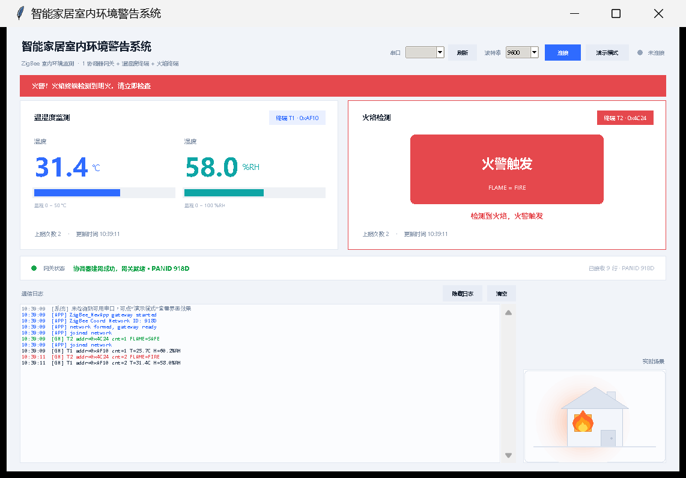
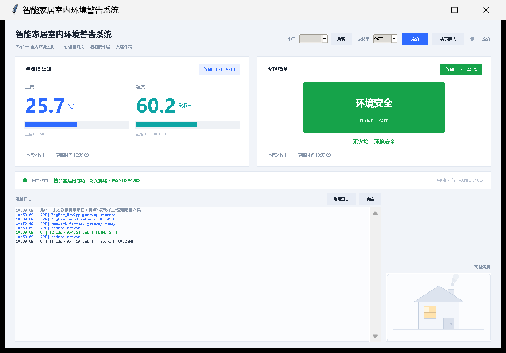

# 智能居家环境报警系统

<p align="center">
  <b>CC2530 + Z-Stack：温湿度终端 + 火焰终端 → 协调器网关 → 居家平面图与火警联动</b><br/>
  <sub>CC2530F256 · Z-Stack 2.5.1a · IAR EW8051 · Python + tkinter</sub>
</p>

<p align="center">
  
</p>

这个项目在温湿度监测的基础上多加了一个火焰终端，重点不在「多一个传感器」，而在**两种上报时机并存**：
温湿度按周期上报，火焰只在**状态变化**时上报。事件驱动与周期轮询共存在一条链路上，
是合集里最能体现 OSAL 事件机制用法的一个。

---

## 一、系统组成

| 节点 | 角色 | 采集 / 动作 | 编译配置 |
|---|---|---|---|
| 协调器网关 | 建网、收数据、串口转发 | 按 `nodeType` 区分载荷；火警时 LED3 闪烁 | `CoordinatorEB` |
| 温湿度终端 | 周期采集 | DHT11，5 s 一帧 | `SensorTerminalEB` |
| 火焰终端 | 事件触发 | 火焰传感器；**状态一变立刻上报**，不等待周期 | `FlameTerminalEB` |
| 路由中继（可选） | 拉远距离用 | 与温湿度终端同一份代码 | `RouterEB` |

---

## 二、界面预览

| 火警触发 | 环境安全 |
|---|---|
|  |  |

左侧是居家平面图，温湿度卡片与火焰卡片分列两侧。火警一旦触发：平面图上的火源点亮、
整体配色转红、顶部出现报警条；火焰恢复安全后自动回到常态界面。
两种终端共用一个 10 字节帧，界面侧同样**按帧内容判断类型**（含 `FLAME=` 的是火焰帧），
不依赖节点编号，避免上电顺序不同导致左右卡片错位。

---

## 三、串口协议

协调器 UART0，9600-8-N-1：

```
[APP] ZigBee_NewApp gateway started
[APP] ZigBee Coord Network ID: 918D
[APP] network formed, gateway ready
[GW] T1 addr=0x796F cnt=3 T=25.6C H=60.5%RH
[GW] T2 addr=0x1234 cnt=1 FLAME=FIRE
[GW] T2 addr=0x1234 cnt=2 FLAME=SAFE
```

| 字段 | 含义 |
|---|---|
| `T1` / `T2` | 网关按短地址首次出现顺序编号 |
| `addr` | 终端 16 位短地址 |
| `cnt` | 该终端累计上报次数 |
| `T` / `H` | 温度 ℃ / 湿度 %RH |
| `FLAME` | `FIRE` 检测到明火 / `SAFE` 安全 |

注意 `FLAME` 帧的 `cnt` 增长很慢——它只在状态翻转时才上报，不是每 5 s 一帧。

---

## 四、上报数据帧（10 字节，小端）

| 偏移 | 字段 | 说明 |
|:-:|---|---|
| 0 | nodeType | 1 = 温湿度终端，2 = 火焰终端 |
| 1-2 | addr | 终端短地址 |
| 3-4 | count | 上报次数 |
| 5-6 | temp | 温度，单位 0.1 ℃（有符号） |
| 7-8 | hum | 湿度，单位 0.1 %RH |
| 9 | flame | 1 检测到明火，0 安全 |

链路参数：端点 20、Profile `0x0F08`、上报簇 1、终端 → `0x0000` 单播。

温湿度帧填 `temp` / `hum`，火焰帧只关心第 9 字节；两种载荷复用同一帧结构，解析端按 `nodeType` 分支即可。

---

## 五、上报时机

```
温湿度终端：入网 → 启动 5 s 周期定时器 → 每次超时采一次、上报一次
                    ↓
火焰终端：  入网 → 读取火焰状态 → 与上次相同则什么都不做
                    ↓ 状态翻转
                    └→ 立即单播一帧，LED2 闪一下
```

这样设计的好处：火焰是**安全事件**，晚 5 s 就可能错过；而温湿度是缓慢变化量，周期上报足够。
代价是火焰帧的 `cnt` 不连续，上位机不能拿它当心跳——所以底部状态区显示的是「最近更新时刻」而不是帧率。

---

## 六、判定与指示

| 量 | 判定 | 网关指示 | 上位机表现 |
|---|---|---|---|
| 明火 | `FLAME=FIRE` | LED3 闪烁 | 平面图火源点亮、界面转红、报警条 |
| 明火 | `FLAME=SAFE` | LED3 熄灭 | 回到常态界面 |
| 温度 | > 30 ℃ 偏热 | — | 卡片转橙 |
| 湿度 | > 85 %RH 偏湿 | — | 卡片转蓝 |

LED 约定：LED1 = 无线发送 / 温湿度上报；LED2 = 入网成功 / 火焰安全上报；LED3 = 未入网或发送失败 / 火警报警。

---

## 七、目录结构

```
智能居家环境报警系统/
├── README.md
├── Components/
├── Projects/zstack/
│   └── Samples/ZigBee_NewApp/
│       ├── CC2530DB/ZigBee_NewApp.eww           IAR 工作区
│       ├── Source/NewApp.c/.h                   应用层（双终端角色分支）
│       ├── Source/sensor.c/.h                   DHT11 + 火焰驱动（含模拟数据）
│       ├── Source/OSAL_NewApp.c                 OSAL 任务表
│       └── README.md                            完整技术文档
└── 上位机/
    ├── zigbee_monitor.py
    ├── requirements.txt
    └── 预览图/
```

---

## 八、快速开始

### 8.1 上位机

```bash
cd 上位机
pip install pyserial
python zigbee_monitor.py              # 自动扫描串口
python zigbee_monitor.py --port COM3  # 指定串口
python zigbee_monitor.py --demo       # 无硬件演示
python zigbee_monitor.py --selftest   # 只跑解析自检，验证帧格式
```

### 8.2 固件

1. IAR 打开 `CC2530DB/ZigBee_NewApp.eww`；
2. `CoordinatorEB` → 协调器；`SensorTerminalEB` → 温湿度终端；`FlameTerminalEB` → 火焰终端；
3. 各自 `Rebuild All` 后用 CC Debugger 烧写；
4. 先协调器建网，再两个终端入网。

### 8.3 传感器

`sensor.h` 中 `SENSOR_SIMULATE` 默认 1：温湿度输出缓慢变化值，火焰**每 30 s 出现 5 s 的「有火」窗口**，
不接任何模块就能看到完整的报警 → 恢复过程。接真实模块时改为 0，并核对引脚：

| 传感器 | 宏 | 默认 |
|---|---|---|
| DHT11 数据脚 | `SENSOR_DHT11_BIT` | P0.6 |
| 火焰传感器 | `SENSOR_FLAME_BIT` | P0.5 |
| 火焰有效电平 | `SENSOR_FLAME_ACTIVE_HIGH` | 0（低电平表示有火） |

> 若模块高电平表示检测到火焰，把 `SENSOR_FLAME_ACTIVE_HIGH` 改成 1，否则会一直报警或一直不报警。

---

## 九、验收要点

| 编号 | 测试项 | 操作 | 预期 |
|:-:|---|---|---|
| T1 | 建网 | 协调器上电 | 打印 PANID 与 `gateway ready` |
| T2 | 双终端入网 | 两个终端上电 | 各自 LED2 闪，网关收到两类帧 |
| T3 | 周期上报 | 不做操作 | 温湿度帧每 5 s 一帧 |
| T4 | 事件上报 | 等待火焰翻转（或遮挡火源） | 状态一变立刻出现 `FLAME=FIRE`，不等周期 |
| T5 | 火警指示 | 火警期间观察网关 | LED3 闪烁；上位机转红并出现报警条 |
| T6 | 恢复 | 火焰消失 | 出现 `FLAME=SAFE`，界面回到常态 |
| T7 | 按键补报 | 按终端 S1 | 立即单播一帧，本地 LED 闪一下 |

---

## 十、完整文档

编译配置、按键 / LED 定义、传感器接线与全部验收项，见
[`Projects/zstack/Samples/ZigBee_NewApp/README.md`](Projects/zstack/Samples/ZigBee_NewApp/README.md)。
