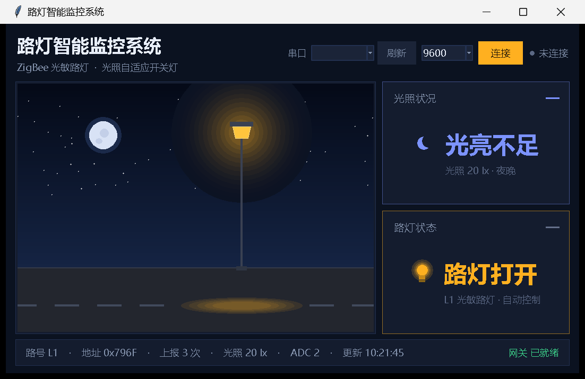
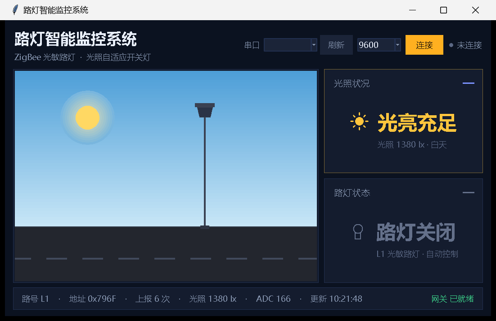
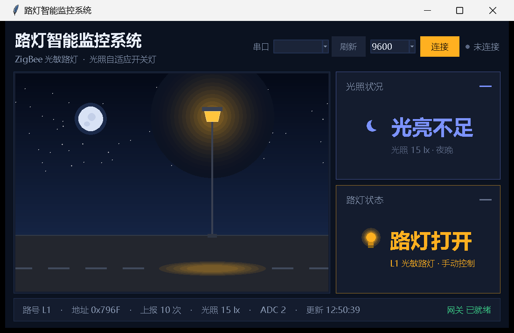
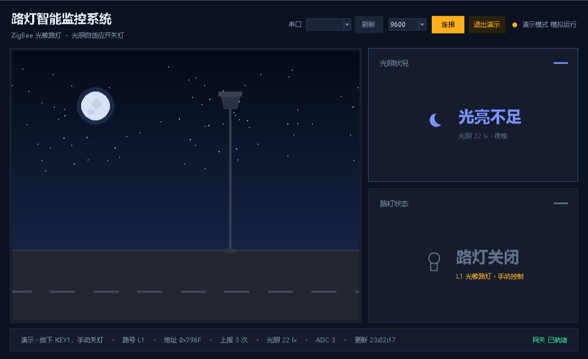

# 智能路灯监控

<p align="center">
  <b>CC2530 + Z-Stack：光敏路灯终端 ⇄ 协调器网关，上行状态 + 下行控制</b><br/>
  <sub>CC2530F256 · Z-Stack 2.5.1a · IAR EW8051 · Python + tkinter</sub>
</p>

<p align="center">
  
</p>

合集里唯一带**下行控制**的项目：不只是「终端上报、上位机显示」，网关还能按 KEY1 远程下发开灯 / 关灯命令，
节点侧再按「手动优先」策略决定听谁的。一条链路上同时跑两种方向的报文，是这个项目最主要的增量。

---

## 一、系统组成

| 节点 | 角色 | 采集 / 动作 | 编译配置 |
|---|---|---|---|
| 协调器网关 | 建网、收数据、下发控制 | LED1 镜像路灯状态；KEY1 远程切换开 / 关 | `CoordinatorEB` |
| 光敏路灯终端 | 采集 + 本地控制 | 采光照，低于阈值自动开灯；KEY1 手动切换；摇杆中键回自动 | `LightTerminalEB` |
| 第二路灯终端（可选） | 第二路段 | 与主终端**同一份代码**，只换输出目录 | `Light2TerminalEB` |
| 路由中继（可选） | 拉远距离用 | 同终端代码 | `RouterEB` |

网关按终端短地址首次出现顺序编号为 `L1`、`L2`，两路可同时接入。

---

## 二、界面预览

| 光亮充足 · 关灯 | 光亮不足 · 开灯 | 手动开灯 | 演示模式 |
|---|---|---|---|
|  |  |  |  |

界面只回答两个问题：**光亮够不够**、**灯开没开**。左侧夜景随光照等级与路灯状态实时变化——
天黑灯亮时路面有光晕，天亮灯灭时场景转亮。路灯卡片的副标题会注明当前是「自动控制」还是「手动控制」，
手动状态下即使光照变化也不会自动切换，这一点必须在界面上看得见。

---

## 三、串口协议

协调器 UART0，9600-8-N-1：

```
[GW] L1 addr=0x796F cnt=4 LUX=1260 ADC=160 LEVEL=DAY LAMP=OFF MODE=AUTO
[GW] L1 addr=0x796F cnt=9 LUX=18 ADC=2 LEVEL=NIGHT LAMP=ON MODE=AUTO
[GW] L1 addr=0x796F cnt=12 LUX=1320 ADC=168 LEVEL=DAY LAMP=ON MODE=MANUAL_ON
```

| 字段 | 含义 |
|---|---|
| `L1` | 路灯编号 |
| `addr` | 终端 16 位短地址 |
| `cnt` | 累计上报次数 |
| `LUX` / `ADC` | 光照强度 lx / 光敏原始采样 |
| `LEVEL` | `NIGHT` / `DUSK` / `DAY` |
| `LAMP` | `ON` 开灯 / `OFF` 关灯 |
| `MODE` | `AUTO` 自动 / `MANUAL_ON` 手动开 / `MANUAL_OFF` 手动关 |

---

## 四、报文格式

**上报帧（11 字节，小端，簇 1，终端 → 0x0000）**

| 偏移 | 字段 | 说明 |
|:-:|---|---|
| 0 | nodeType | 1 = 光敏路灯终端 |
| 1-2 | addr | 终端短地址 |
| 3-4 | count | 上报次数 |
| 5-6 | lux | 光照强度 lx |
| 7 | lamp | 1 开灯 / 0 关灯 |
| 8 | level | 0 夜晚 / 1 微亮 / 2 白天 |
| 9 | adc | 光敏原始采样 0~255 |
| 10 | mode | 0 自动 / 1 手动开 / 2 手动关 |

**控制帧（1 字节，簇 2，网关 → 终端）**

| 值 | 含义 |
|:-:|---|
| 0 | `AUTO` 回到自动 |
| 1 | `FORCE_ON` 强制开灯 |
| 2 | `FORCE_OFF` 强制关灯 |

链路参数：端点 20、Profile `0x0F08`、上报簇 1、控制簇 2。

---

## 五、控制逻辑

```
读光照 lux
   ↓
level = lux < 80 ? NIGHT : (lux < 250 ? DUSK : DAY)
   ↓
lamp = 手动开灯(FORCE_ON)  ? ON          ← KEY1 手动
     : 手动关灯(FORCE_OFF) ? OFF         ← KEY1 手动
     : (level == NIGHT)    ? ON : OFF    ← AUTO 自动策略
   ↓
LED1 亮 = 路灯开
   ↓
组帧单播给网关（附带 mode，告诉上位机当前听谁的）
```

**手动优先，且不设超时**：手动开灯后即使天亮了也保持点亮；手动关灯后天黑了也保持熄灭；
直到再按一次 KEY1 切换，或按摇杆中键回到 `AUTO`——回到自动时立即按当前光照重新决策一次并回传，
网关和上位机马上能看到变化。

阈值与周期（`Source/NewApp.h`）：`NEWAPP_LUX_NIGHT` = 80 lx、`NEWAPP_LUX_DUSK` = 250 lx、
`NEWAPP_LIGHT_REPORT_PERIOD` = 3000 ms。

---

## 六、目录结构

```
智能路灯监控/
├── README.md
├── Components/
├── Projects/zstack/
│   └── Samples/ZigBee_NewApp/
│       ├── CC2530DB/ZigBee_NewApp.eww           IAR 工作区（4 个配置）
│       ├── Source/NewApp.c/.h                   应用层：光照判定 + 手动状态机
│       ├── Source/sensor.c/.h                   光敏驱动（含模拟数据）
│       ├── Source/OSAL_NewApp.c                 OSAL 任务表
│       └── README.md                            完整技术文档
└── 上位机/
    ├── light_monitor.py
    ├── requirements.txt
    └── 预览图/
```

---

## 七、快速开始

### 7.1 上位机

```bash
cd 上位机
python light_monitor.py --demo   # 无硬件演示
python light_monitor.py COM3     # 指定串口
python light_monitor.py          # 自动扫描
```

演示剧本：黄昏渐暗 → 入夜自动开灯 → 深夜 → KEY1 手动关灯 / 开灯 → 摇杆恢复自动 → 破晓 → 白天关灯，
把自动、手动、恢复三种状态都走一遍。

### 7.2 固件

1. IAR 打开 `CC2530DB/ZigBee_NewApp.eww`；
2. `CoordinatorEB` → 协调器；`LightTerminalEB` → 路灯终端（要两路就再烧一块 `Light2TerminalEB`）；
3. 先协调器建网，再终端入网。

### 7.3 光敏传感器

`sensor.h` 中 `SENSOR_LIGHT_SIMULATE` 默认 1，输出 **60 s 走完一个昼夜** 的曲线
（0~8 s 夜晚 → 8~14 s 黎明 → 14~40 s 白天 → 40~46 s 黄昏 → 46~60 s 夜晚），
不接模块就能看到完整的自动开关灯过程。接真实模块时改为 0：

| 方式 | 宏 | 默认引脚 |
|---|---|---|
| 模拟量 AO（推荐，可读具体 lx） | `SENSOR_LIGHT_ADC_CHN` | P0.5 / AIN5 |
| 开关量 DO（只能判亮 / 暗） | `SENSOR_LIGHT_DO_BIT` | P0.4 |

> P0.6 / AIN6 被摇杆方向识别占用，光敏不要接 P0.6。

---

## 八、验收要点

| 编号 | 测试项 | 操作 | 预期 |
|:-:|---|---|---|
| T1 | 建网入网 | 协调器先上电，终端后上电 | 出现 `L1` 帧，`MODE=AUTO` |
| T2 | 自动开灯 | 遮挡光敏或等模拟曲线入夜 | `LEVEL=NIGHT` 时 `LAMP=ON`，终端 LED1 亮 |
| T3 | 自动关灯 | 给光敏照光或等天亮 | `LEVEL=DAY` 时 `LAMP=OFF` |
| T4 | 手动开灯 | 按终端 KEY1 | `MODE=MANUAL_ON`，`LAMP=ON`，此后光照变亮也不关灯 |
| T5 | 恢复自动 | 按摇杆中键 | `MODE=AUTO`，立即按当前光照重新决策 |
| T6 | 远程控制 | 按网关 KEY1 | 终端路灯状态跟随变化，网关 LED1 同步 |
| T7 | 双路上报（可选） | 两块终端同时入网 | 分别出现 `L1` / `L2`，互不干扰 |

---

## 九、完整文档

编译配置、按键 / LED 定义、光敏校准与全部验收项，见
[`Projects/zstack/Samples/ZigBee_NewApp/README.md`](Projects/zstack/Samples/ZigBee_NewApp/README.md)。
