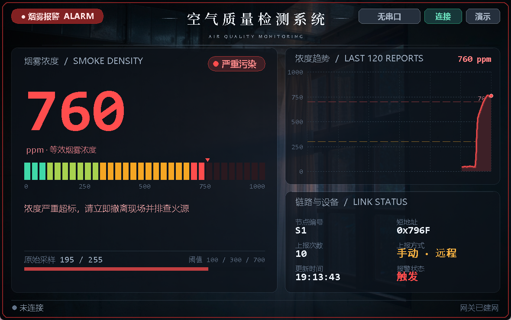
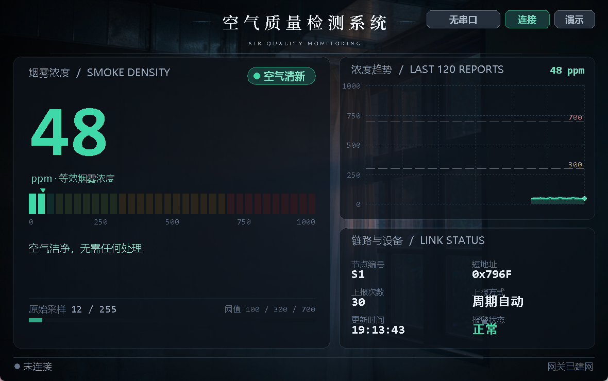

# 空气质量检测

<p align="center">
  <b>CC2530 + Z-Stack：烟雾终端 → 协调器网关，四档分级 + 网关反向请求补报</b><br/>
  <sub>CC2530F256 · Z-Stack 2.5.1a · IAR EW8051 · Python + tkinter + Pillow</sub>
</p>

<p align="center">
  
</p>

烟雾浓度不是一个开关量，而是一条连续曲线：刚有点异味、明显烟雾、浓烟报警，对应的处置完全不同。
这个项目把浓度分成四档，并给每一帧打上**来源标记**——是周期上报、本机按键触发，还是网关主动请求的。
后者意味着链路上多了一条下行指令通道。

---

## 一、系统组成

| 节点 | 角色 | 采集 / 动作 | 编译配置 |
|---|---|---|---|
| 协调器网关 | 建网、收数据、下发请求 | 按等级驱动 LED 报警；KEY1 请求终端立即补报一帧 | `CoordinatorEB` |
| 烟雾终端 | 周期采集 + 本地报警 | MQ-2 类传感器，5 s 一帧；超标时本地报警灯亮 / 闪 | `SmokeTerminalEB` |
| 路由中继（可选） | 拉远距离用 | 与终端同一份代码 | `RouterEB` |

角色宏集中在 `NewApp.h` 末尾的三段 `#if defined(...)`，编译配置里只给一个角色宏，
`NEWAPP_IS_TERMINAL`、`NEWAPP_NODE_TYPE` 等派生宏由头文件自动算出。

---

## 二、界面预览

| 空气清新 | 烟雾报警 |
|---|---|
|  |  |

界面用写实照片底图加半透明玻璃面板（Pillow 后台合成，不是卡通插画）：左侧是大号数码读数与
32 段 LED 光柱，右侧是扫描式浓度波形与设备信息表。浓度进入「严重」档时，面板描边与顶部报警条
会红色脉冲呼吸。

---

## 三、串口协议

协调器 UART0，9600-8-N-1：

```
[APP] ZigBee_NewApp gateway started
[APP] network formed, gateway ready
[GW] S1 addr=0x796F cnt=7 SMOKE=742 ADC=189 LEVEL=DANGER SRC=REMOTE
[GW] S1 addr=0x796F cnt=8 SMOKE=120 ADC=30 LEVEL=NORMAL SRC=PERIODIC
```

| 字段 | 含义 |
|---|---|
| `S1` | 网关按终端短地址首次出现顺序分配的编号 |
| `addr` | 终端 16 位短地址 |
| `cnt` | 该终端累计上报次数 |
| `SMOKE` | 烟雾浓度 0~1000（等效 ppm） |
| `ADC` | 传感器原始采样 0~255，用于判断模块是否正常 |
| `LEVEL` | `CLEAN` 清新 / `NORMAL` 轻度异味 / `WARN` 明显烟雾 / `DANGER` 严重 |
| `SRC` | `PERIODIC` 周期上报 / `KEY` 本机按键 / `REMOTE` 网关请求 |

---

## 四、报文格式

**上报帧（10 字节，小端，簇 1，终端 → 0x0000）**

| 偏移 | 字段 | 说明 |
|:-:|---|---|
| 0 | nodeType | 固定 1（烟雾终端） |
| 1-2 | addr | 终端短地址 |
| 3-4 | count | 上报次数 |
| 5-6 | density | 烟雾浓度 0~1000 |
| 7 | adc | 原始采样 0~255 |
| 8 | level | 0 清新 / 1 轻度 / 2 超标 / 3 严重 |
| 9 | src | 0 周期 / 1 本机按键 / 2 网关请求 |

**控制帧（1 字节，簇 2，网关 → 终端）**：`0 = REPORT_NOW`，请求立即补报一帧。

链路参数：端点 20、Profile `0x0F08`、上报簇 1、控制簇 2。

---

## 五、判定逻辑

```
读 ADC → density = adc * 1000 / 255（模块反相时改 SENse 方向）
   ↓
density >= 700 → DANGER   严重
density >= 300 → WARN     明显烟雾
density >= 100 → NORMAL   轻度异味
否则            → CLEAN    清新
   ↓
LED1 报警：DANGER 无限闪 / WARN 常亮 / 其余熄灭
   ↓
组帧单播给网关，同时在本地串口回显
```

| 宏（`Source/NewApp.h`） | 默认 | 含义 |
|---|---|---|
| `NEWAPP_SMOKE_NORMAL` | 100 | 高于此值：轻度异味 |
| `NEWAPP_SMOKE_WARN` | 300 | 高于此值：明显烟雾 |
| `NEWAPP_SMOKE_DANGER` | 700 | 高于此值：严重，声光报警 |
| `NEWAPP_REPORT_PERIOD` | 5000 ms | 周期上报间隔 |
| `NEWAPP_FIRST_REPORT_DELAY` | 500 ms | 入网后首帧延迟 |

判定在**终端**完成（因为它要驱动本地报警灯），等级随帧上报，上位机只负责呈现，不再重复计算。

---

## 六、目录结构

```
空气质量检测/
├── README.md
├── Components/
├── Projects/zstack/
│   └── Samples/ZigBee_NewApp/
│       ├── CC2530DB/ZigBee_NewApp.eww           IAR 工作区
│       ├── Source/NewApp.c/.h                   应用层：分级 + 上报 + 响应请求
│       ├── Source/sensor.c/.h                   烟雾驱动（含模拟数据）
│       ├── Source/OSAL_NewApp.c                 OSAL 任务表
│       └── README.md                            完整技术文档
└── 上位机/
    ├── 空气质量监测.py
    ├── assets/bg.jpg                            写实底图
    ├── requirements.txt
    └── 预览图/
```

---

## 七、快速开始

### 7.1 上位机

```bash
cd 上位机
pip install pyserial pillow
python 空气质量监测.py --demo   # 无硬件演示
python 空气质量监测.py COM3     # 指定串口
python 空气质量监测.py          # 自动扫描
```

### 7.2 固件

1. IAR 打开 `CC2530DB/ZigBee_NewApp.eww`；
2. `CoordinatorEB` → 协调器；`SmokeTerminalEB` → 烟雾终端；
3. 先协调器建网，再终端入网。

### 7.3 传感器

`sensor.h` 中 `SENSOR_SMOKE_SIMULATE` 默认 1，按开机时间生成 **90 s 一轮**的曲线
（清新 → 轻度异味 → 明显烟雾 → 重度 → 通风回落），刚好覆盖上位机四档配色与报警动画。
接真实模块时改为 0：

| 宏 | 默认 | 说明 |
|---|---|---|
| `SENSOR_SMOKE_USE_ADC` | 1 | 1 = 模拟量 AO 接 ADC；0 = 开关量 DO |
| `SENSOR_SMOKE_ADC_CHN` | `HAL_ADC_CHANNEL_5` | AO 接 P0.5 / AIN5 |
| `SENSOR_SMOKE_DO_BIT` | `BV(4)` | DO 接 P0.4 |
| `SENSOR_SMOKE_ADC_RISING` | 1 | 0 表示 ADC 越大浓度越低（反相） |
| `SENSOR_SMOKE_DO_ACTIVE_HIGH` | 1 | 0 表示 DO 低电平报警 |

> 摇杆方向识别占用 P0.6 / AIN6，烟雾传感器默认放 P0.5，别接 P0.6。

---

## 八、验收要点

| 编号 | 测试项 | 操作 | 预期 |
|:-:|---|---|---|
| T1 | 建网入网 | 协调器先上电，终端后上电 | 出现 `S1` 帧，`SRC=PERIODIC` |
| T2 | 周期上报 | 不做操作 | 每 5 s 一帧，`cnt` 连续递增 |
| T3 | 四档分级 | 用烟雾 / 打火机气体靠近（模拟模式则等曲线） | `LEVEL` 依次出现 `CLEAN → NORMAL → WARN → DANGER` |
| T4 | 本地报警 | 进入 `WARN` / `DANGER` | LED1 常亮 / 闪烁 |
| T5 | 网关请求补报 | 按网关 KEY1 | 终端立即回一帧，`SRC=REMOTE`，`cnt` 加 1 |
| T6 | 本机按键 | 按终端 KEY1 | 立即上报一帧，`SRC=KEY` |
| T7 | 上位机 | 连接串口 | 数码读数、32 段光柱、波形同步；`DANGER` 时红色脉冲 |

---

## 九、完整文档

编译配置、按键 / LED 定义、传感器校准与全部验收项，见
[`Projects/zstack/Samples/ZigBee_NewApp/README.md`](Projects/zstack/Samples/ZigBee_NewApp/README.md)。
